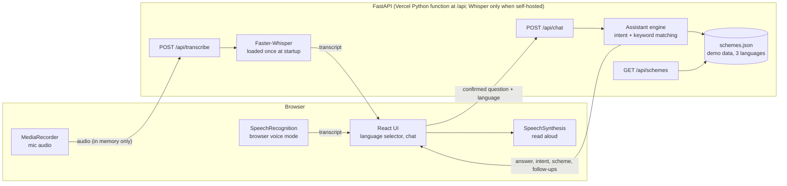

# BhashaBuddy

**Government services, explained in your language.**

BhashaBuddy is a voice-first assistant that helps people in India understand government schemes, certificates and public services in Telugu, Hindi or English. You speak or type a question, check the transcript, and get a short, simple answer with the documents and steps involved. The answer can be read aloud.

Built for the Scaler × Wispr Flow "Build for Bharat" hackathon. It runs without paid API keys and deploys as a single Vercel project. Answers come from a local dataset served by a FastAPI function, voice input uses the browser's speech recognition (or the open-source Faster-Whisper when you run the backend yourself), and read-aloud uses the browser's built-in speech engine.

> **Demo information.** The scheme data in this project is sample data written for the demo. It is not verified current government information. Always check eligibility and requirements on the official government portal before applying.

---

## 1. Problem

Government websites are often in formal English, spread across many portals, and hard to use on a phone. Families who need an income certificate for a scholarship, or a pension for an elderly parent, often depend on agents or long queues just to learn which documents to bring. Language, literacy and confidence with technology are all barriers.

## 2. Target users

- Students applying for scholarships and certificates
- Farmers
- Senior citizens and their families
- Women, including pregnant women and new mothers
- Rural and semi-urban families
- Anyone uncomfortable with complicated government websites

## 3. Features

- **Voice input in Telugu, Hindi and English.** Two modes, picked automatically:
  - **Whisper mode** (backend running with Faster-Whisper, e.g. locally): audio is recorded with MediaRecorder and transcribed on the server.
  - **Browser mode** (Vercel deployment): the browser's built-in speech recognition (Chrome, Edge, Android Chrome) converts speech to text.
- **Transcript confirmation.** You see what was heard and can edit it, send it, or record again. Nothing is sent to the assistant unchecked.
- **Read-aloud answers.** Uses the browser's SpeechSynthesis with a voice matching the selected language. If the device has no Telugu or Hindi voice, the app says so instead of reading the text with the wrong voice.
- **Rule-based assistant, no LLM.** Detects intent (documents, eligibility, how to apply, general info), matches the service, and answers only from the dataset. It remembers the last service, so "What documents are needed?" works as a follow-up.
- **Honest by design.** Every answer carries a "Demo, not verified" label. Unknown services get "I don't have verified information about that service yet." It never claims to submit or track an application.
- **Safety handling.** Warns users never to share OTPs, passwords or PINs; points to 112 and Tele-MANAS (14416) for emergencies; refuses prompt-injection attempts.
- **Works without a microphone.** Text input and clickable sample questions cover the full demo.
- **Mobile-first UI.** Large touch targets, Indic fonts (Noto Sans Telugu and Devanagari), reduced-motion support, screen-reader labels.
- **Graceful failure.** Mic permission denied, speech model unavailable, backend offline, no TTS voice: each shows a clear message and the app keeps working.

## 4. Architecture



Static frontend and API are served from the same Vercel domain: `vercel.json` rewrites `/api/*` and `/health` to the Python function in [api/index.py](api/index.py), which imports the FastAPI app from `backend/`. Whisper does not fit within Vercel's function size and CPU limits, so on Vercel the app uses browser speech recognition instead.

**Request flow for a voice question (Whisper mode)**

1. The user picks a language and taps the mic. The browser asks for microphone permission.
2. Audio is recorded with MediaRecorder (up to 60 seconds) and posted to `/api/transcribe` with the language hint.
3. Faster-Whisper transcribes it in memory. The audio is never written to disk or stored.
4. The user reviews and edits the transcript, then sends it.
5. `/api/chat` detects the intent, finds the matching service in `schemes.json`, and builds the answer in the chosen language.
6. The answer is displayed and read aloud.

**How the assistant decides what to say** ([backend/app/assistant.py](backend/app/assistant.py))

1. Safety checks run first: emergency, prompt injection, sensitive data (OTP, PIN), and requests to submit or track applications.
2. The question intent is detected from multilingual keywords: documents, eligibility, application steps, or general info.
3. The service is matched by keyword score. If none matches, the last discussed service is used for follow-ups.
4. If the question names something not in the dataset (for example "passport"), it answers honestly that it has no verified information. If the question is generic ("How do I apply?"), it asks which service.
5. The answer is assembled from the dataset fields only. The code never invents eligibility rules, amounts or deadlines.

## 5. Tech stack

| Layer | Choice |
|---|---|
| Frontend | React 19, Vite, TypeScript, Tailwind CSS 4, lucide-react |
| Backend | Python 3.12, FastAPI, Pydantic v2 |
| Speech-to-text | Faster-Whisper (CTranslate2, CPU, int8) |
| Text-to-speech | Browser SpeechSynthesis API |
| Data | `backend/data/schemes.json` (9 services, en/hi/te) |
| Hosting | Vercel: static frontend plus a Python function for the API |

## 6. Project structure

```
backend/
  app/main.py          FastAPI app, endpoints, Whisper loader, validation
  app/assistant.py     intent detection, matching, multilingual templates
  data/schemes.json    demo dataset
  tests/test_api.py    pytest suite
  requirements.txt
frontend/
  src/App.tsx          UI: hero, chat, voice panel, composer
  src/hooks.ts         useRecorder (MediaRecorder) and useSpeech (SpeechSynthesis)
  src/api.ts           API client, reads VITE_API_BASE_URL
  src/i18n.ts          UI strings in Telugu, Hindi, English
api/index.py           Vercel Python function entry point (imports backend/app)
vercel.json            Vercel build, function and rewrite config
requirements.txt       Python dependencies for the Vercel function (no Whisper)
Dockerfile             one image: built frontend + FastAPI + Faster-Whisper
docker-compose.yml     one-command start
```

## 7. Local setup

### Quick start with Docker (one command)

```bash
docker compose up --build
```

Open http://localhost:8000. This runs the full app, including Faster-Whisper voice input, in one container. No API keys or `.env` file needed.

- On first start the Whisper `base` model (about 145 MB) downloads into a Docker volume. Voice input is ready about a minute later, and the badge changes from "Voice is starting…" to "Voice ready". Text questions work immediately.
- Port 8000 already in use? `PORT=8080 docker compose up --build`, then open http://localhost:8080.
- Better Telugu and Hindi recognition: `WHISPER_MODEL=small docker compose up --build` (needs about 1 GB RAM).
- Stop with `docker compose down`.

### Manual setup

Requirements: Python 3.10 or newer, Node.js 20 or newer. No API keys.

### Backend

```bash
cd backend
python3 -m venv .venv
source .venv/bin/activate
pip install -r requirements-dev.txt
uvicorn app.main:app --reload --port 8000
```

Check it: `curl http://localhost:8000/health`

### Frontend

```bash
cd frontend
npm install
npm run dev
```

Open http://localhost:5173. In dev mode the frontend calls `http://localhost:8000` unless `VITE_API_BASE_URL` is set. If you run the backend on another port, start the frontend with `VITE_API_BASE_URL=http://localhost:PORT npm run dev` and add the frontend origin to `ALLOWED_ORIGINS` for the backend.

## 8. Speech-to-text setup

- The Whisper model is **downloaded once on first start** from Hugging Face (`base` is about 145 MB) and cached in `~/.cache/huggingface`. Later starts load it from the cache.
- It loads in a background thread at startup, so `/health` answers immediately. While it loads, `/health` reports `"speech_to_text": "loading"` and the UI shows "Voice is starting…".
- If the model cannot load (no network, not enough memory), voice input is disabled with a clear message and text chat keeps working.

| Variable | Default | Notes |
|---|---|---|
| `WHISPER_ENABLED` | `true` | `false` turns off voice input entirely |
| `WHISPER_MODEL` | `base` | `tiny`, `base`, `small`, `medium`. `small` is noticeably better for Telugu and Hindi but needs about 1 GB RAM |
| `WHISPER_DEVICE` | `cpu` | `cuda` if you have a GPU |
| `WHISPER_COMPUTE_TYPE` | `int8` | |
| `MAX_AUDIO_MB` | `10` | upload size limit |
| `ALLOWED_ORIGINS` | `http://localhost:5173,http://127.0.0.1:5173` | comma-separated frontend URLs |
| `ALLOWED_ORIGIN_REGEX` | unset | optional, for Vercel preview URLs |

Measured peak memory while transcribing (CPU, int8): `tiny` about 343 MB, `base` about 384 MB.

## 9. Demo script for judges

You can test everything without speaking: the sample question tiles and text box run the same flow as voice.

1. Open the app. The language is Telugu by default (తెలుగు).
2. Tap the mic and ask about scholarships, for example "స్కాలర్‌షిప్ గురించి చెప్పండి". Or tap the **విద్యార్థి స్కాలర్‌షిప్** tile.
3. Check the transcript in the review panel, fix any words, and tap **ప్రశ్న పంపండి**.
4. Read the simple explanation. The answer is read aloud if your device has a Telugu voice. Otherwise the app tells you no voice is installed. Switch to Hindi to hear read-aloud on most desktop Chrome installs.
5. Ask the follow-up "ఏ పత్రాలు కావాలి?" (What documents are needed?). It remembers you were asking about scholarships.
6. Note the **Demo, not verified** label on every answer, the official source link where one exists, and the disclaimer.

Other things to try:

- "How do I get a passport?": honest "no verified information" answer.
- "My OTP is 1234": safety warning.
- "Check my application status": explains it cannot submit or track applications.
- "Explain PM Kisan in simple Telugu": switches the answer language.

## 10. Testing

```bash
cd backend
source .venv/bin/activate
pytest -q
```

The suite (15 tests) covers dataset shape and honesty, scheme endpoints, intent detection, documents, eligibility, application steps, context follow-ups, Telugu and Hindi matching, unsupported questions, safety intents, request validation, and transcription errors (model unavailable, wrong file type, oversize upload, undecodable audio). Tests run with Whisper disabled, so they need no model download.

Frontend: `cd frontend && npm run build` type-checks and builds.

## 11. Deploying to Vercel

Everything (frontend and API) deploys as one Vercel project from the **repository root**.

```bash
cd BashaBuddy          # repository root, not frontend/
npx vercel --prod
```

On first run choose **Create a new project**. Leave **Root Directory** empty (the repository root). Do **not** set `VITE_API_BASE_URL`: the frontend calls `/api` on its own domain. All build settings live in [vercel.json](vercel.json):

- Install: `cd frontend && npm ci`, build: `cd frontend && npm run build`, output: `frontend/dist`
- Python function `api/index.py` with dependencies from the root `requirements.txt`
- Rewrites `/api/*` and `/health` to the function

Importing the GitHub repository in the Vercel dashboard works the same way (root directory empty, no environment variables needed).

**Voice on Vercel.** Speech-to-text uses the browser's speech recognition, which works in Chrome, Edge and Android Chrome. Firefox and some Safari versions do not support it; there the mic is disabled and text input still works. Microphone access needs HTTPS, which Vercel provides.

## 12. Running the backend with Whisper (optional)

To use the open-source Faster-Whisper model for voice instead of the browser recognizer, run the backend on any machine or Python host with at least 512 MB RAM (see [Local setup](#7-local-setup) and [Speech-to-text setup](#8-speech-to-text-setup)) and build the frontend with `VITE_API_BASE_URL` pointing at it. The frontend switches to Whisper mode automatically whenever `/health` reports `"speech_to_text": "ready"`.

## 13. Limitations

- **Demo data.** Nine services with general, non-numeric guidance. No income limits, benefit amounts or deadlines, on purpose. Rules vary by state, and the data has not been verified against official sources. `last_verified` is `null` for every entry.
- **Official links.** Only included where the national portal responded when this project was built (scholarships.gov.in, nfsa.gov.in, pmmvy.wcd.gov.in, uidai.gov.in). Others show "Please verify through the official government portal."
- **Rule-based understanding.** Keyword matching handles common phrasings in all three languages, including Telugu and Hindi suffixes, but it will miss unusual wording. It does not reason about a user's personal situation and never confirms eligibility.
- **Speech accuracy.** Browser recognition quality depends on the browser and is unavailable in Firefox. Whisper `base` is weak on Telugu and on mixed-language speech; `small` is much better but needs more memory. The transcript review step exists for this reason.
- **Read-aloud** depends on the voices installed on the device. Many Android phones have Hindi and Telugu voices; many desktop browsers lack Telugu.
- **No persistence.** Conversations live only in the browser tab. Feedback is counted in memory and resets on restart.

## 14. Safety and data privacy

- **No accounts and no personal data collected.** The app never asks for names, Aadhaar numbers, OTPs, passwords or bank details, and warns users who offer them.
- **Recordings are not stored by BhashaBuddy.** In Whisper mode, audio is transcribed in memory and discarded after the request. In browser mode (the Vercel deployment), the browser's own speech service converts speech to text (Chrome uses Google's service) and BhashaBuddy only receives the text.
- **No government database access.** It cannot submit, track or change any application, and says so.
- **Input validation.** Messages are limited to 1000 characters; audio uploads are limited by size and must be an audio type; invalid requests get clear 4xx errors. Errors returned to the browser never contain stack traces or configuration.
- **CORS** is restricted to configured frontend origins. On Vercel the frontend and API share one domain, so no cross-origin access is needed.
- **Untrusted input.** User text is matched against keywords only. It is never executed or used to build prompts, and instructions like "ignore previous instructions" get a refusal.
- **Emergencies** are directed to 112 and Tele-MANAS (14416).
- **No secrets.** The project needs no API keys. `.env` files and model files are git-ignored.

> BhashaBuddy provides general guidance using demo information. Verify important details through official government sources before applying.
